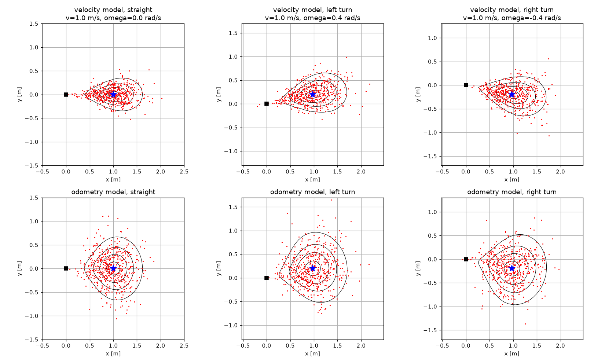

Probabilistic motion models
---------------------------

This example implements the two motion models of chapter 5 of Thrun, Burgard
and Fox, *Probabilistic Robotics* (MIT Press, 2005):

- the velocity motion model, with the control :math:`\mathbf{u} = (v, \omega)`
  and the noise parameters :math:`\alpha_1` to :math:`\alpha_6`
  (Tables 5.1 and 5.3), and
- the odometry motion model, with the control
  :math:`\mathbf{u} = (\bar{\mathbf{x}}_{t-1}, \bar{\mathbf{x}}_t)`, the pair
  of poses reported by the odometry, and the noise parameters
  :math:`\alpha_1` to :math:`\alpha_4` (Tables 5.5 and 5.6).

For each model there is a closed-form function that evaluates the density
:math:`p(\mathbf{x}_t \mid \mathbf{u}_t, \mathbf{x}_{t-1})` at a hypothesised
pose, and a sampler that draws a pose from the same distribution. The samplers
are the prediction step of Monte Carlo localization. The densities are the
same noise model written as a function of the pose, as used by grid-based
Bayes filters.

The states are :math:`\mathbf{x} = (x, y, \theta)`. Distances are in meters,
angles in radians and time in seconds. Only NumPy and Matplotlib are required.

Velocity motion model
~~~~~~~~~~~~~~~~~~~~~

The sampler of Table 5.3 perturbs the commanded velocities with the motion
noise, then integrates the noisy velocities over the time step
:math:`\Delta t`:

.. math::

   \begin{aligned}
   \hat v &= v + \varepsilon_{\alpha_1 v^2 + \alpha_2 \omega^2} ,\\
   \hat \omega &= \omega + \varepsilon_{\alpha_3 v^2 + \alpha_4 \omega^2} ,\\
   \hat \gamma &= \varepsilon_{\alpha_5 v^2 + \alpha_6 \omega^2} ,\\
   x' &= x - \frac{\hat v}{\hat \omega} \sin\theta
        + \frac{\hat v}{\hat \omega} \sin(\theta + \hat\omega \Delta t) ,\\
   y' &= y + \frac{\hat v}{\hat \omega} \cos\theta
        - \frac{\hat v}{\hat \omega} \cos(\theta + \hat\omega \Delta t) ,\\
   \theta' &= \theta + \hat \omega \Delta t + \hat \gamma \Delta t .
   \end{aligned}

Here :math:`\varepsilon_b` is a zero-mean random variable with variance
:math:`b`, and :math:`\hat\gamma` is an additional rotation carried out when
the robot arrives at its final pose. Note that the variance of the noise is
proportional to the squares of the commanded velocities, as in Tables 5.1
and 5.3. When :math:`\hat\omega` is zero the robot moves on a straight line,
which is the limit of the equations above.

The closed-form algorithm of Table 5.1 goes the other way. It recovers the
noise-free controls from the two poses by reconstructing the circle that
carries the robot from the first pose to the second:

.. math::

   \begin{aligned}
   \mu &= \frac{1}{2}\,
          \frac{(x - x')\cos\theta + (y - y')\sin\theta}
               {(y - y')\cos\theta - (x - x')\sin\theta} ,\\
   x^* &= \frac{x + x'}{2} + \mu (y - y') ,\qquad
   y^* = \frac{y + y'}{2} + \mu (x' - x) ,\\
   \Delta\theta &= \operatorname{atan2}(y' - y^*, x' - x^*)
                  - \operatorname{atan2}(y - y^*, x - x^*) ,\\
   \hat v &= \frac{\Delta\theta}{\Delta t}\, r ,\qquad
   \hat \omega = \frac{\Delta\theta}{\Delta t} ,\\
   \hat \gamma &= \frac{\theta' - \theta}{\Delta t} - \frac{\Delta\theta}{\Delta t} .
   \end{aligned}

The density is the product of the densities of the three errors:

.. math::

   \begin{aligned}
   p(\mathbf{x}_t \mid \mathbf{u}_t, \mathbf{x}_{t-1}) &=
     \operatorname{prob}(v - \hat v,\ \alpha_1 v^2 + \alpha_2 \omega^2)\\
   &\quad \cdot \operatorname{prob}(\omega - \hat\omega,\
     \alpha_3 v^2 + \alpha_4 \omega^2)\\
   &\quad \cdot \operatorname{prob}(\hat\gamma,\
     \alpha_5 v^2 + \alpha_6 \omega^2) .
   \end{aligned}

Two poses determine the heading change only modulo :math:`2\pi`. The
difference of the two :math:`\operatorname{atan2}` values is therefore
wrapped to :math:`(-\pi, \pi]`, which assumes that both the turning angle
:math:`|\omega|\Delta t` and the total heading change
:math:`|\omega\Delta t + \gamma\Delta t|` are smaller than :math:`\pi` — the
small-time-step regime of the book. Without the wrap, the
same motion seen from a different global heading is sometimes recovered as
:math:`\omega - 2\pi`, and the density at the true pose becomes zero. A turn
larger than :math:`\pi` per step cannot be distinguished from its
complement.

.. autofunction:: Localization.probabilistic_motion_model.probabilistic_motion_model.velocity_motion_model

.. autofunction:: Localization.probabilistic_motion_model.probabilistic_motion_model.sample_velocity_motion_model

Odometry motion model
~~~~~~~~~~~~~~~~~~~~~

The odometry motion model uses the relative motion between two consecutive
odometry poses. The relative motion is decomposed into an initial rotation
:math:`\delta_{rot1}`, a translation :math:`\delta_{trans}` and a second
rotation :math:`\delta_{rot2}`, as in Figure 5.7 of the book:

.. math::

   \begin{aligned}
   \delta_{rot1} &= \operatorname{atan2}(\bar y' - \bar y, \bar x' - \bar x) - \bar\theta ,\\
   \delta_{trans} &= \sqrt{(\bar x - \bar x')^2 + (\bar y - \bar y')^2} ,\\
   \delta_{rot2} &= \bar\theta' - \bar\theta - \delta_{rot1} .
   \end{aligned}

The decomposition needs the direction of the translation, so it assumes a
nonzero displacement. When the odometry reports the same position twice, for
example a robot rotating in place, that direction is undefined. The
implementation then sets :math:`\delta_{rot1} = 0` and puts the whole
rotation in :math:`\delta_{rot2}`. Without this convention,
:math:`\operatorname{atan2}(0, 0) = 0` would give
:math:`\delta_{rot1} = -\bar\theta`, and the noise, and therefore the
density, would depend on the global heading of the odometry frame.

Each parameter is then perturbed with its own noise:

.. math::

   \begin{aligned}
   \hat\delta_{rot1} &= \delta_{rot1}
     - \varepsilon_{\alpha_1 \delta_{rot1}^2 + \alpha_2 \delta_{trans}^2} ,\\
   \hat\delta_{trans} &= \delta_{trans}
     - \varepsilon_{\alpha_3 \delta_{trans}^2 + \alpha_4 \delta_{rot1}^2 + \alpha_4 \delta_{rot2}^2} ,\\
   \hat\delta_{rot2} &= \delta_{rot2}
     - \varepsilon_{\alpha_1 \delta_{rot2}^2 + \alpha_2 \delta_{trans}^2} ,
   \end{aligned}

and the sampled pose follows from the perturbed values (Table 5.6):

.. math::

   \begin{aligned}
   x' &= x + \hat\delta_{trans} \cos(\theta + \hat\delta_{rot1}) ,\\
   y' &= y + \hat\delta_{trans} \sin(\theta + \hat\delta_{rot1}) ,\\
   \theta' &= \theta + \hat\delta_{rot1} + \hat\delta_{rot2} .
   \end{aligned}

The closed-form algorithm of Table 5.5 decomposes the hypothesised poses
:math:`(\mathbf{x}_{t-1}, \mathbf{x}_t)` in the same way, giving
:math:`\hat\delta_{rot1}, \hat\delta_{trans}, \hat\delta_{rot2}`, and returns
the density of the differences between both decompositions, with all angular
differences wrapped to :math:`[-\pi, \pi)`:

.. math::

   \begin{aligned}
   p_1 &= \operatorname{prob}(\delta_{rot1} - \hat\delta_{rot1},\
     \alpha_1 \delta_{rot1}^2 + \alpha_2 \delta_{trans}^2) ,\\
   p_2 &= \operatorname{prob}(\delta_{trans} - \hat\delta_{trans},\
     \alpha_3 \delta_{trans}^2 + \alpha_4 \delta_{rot1}^2 + \alpha_4 \delta_{rot2}^2) ,\\
   p_3 &= \operatorname{prob}(\delta_{rot2} - \hat\delta_{rot2},\
     \alpha_1 \delta_{rot2}^2 + \alpha_2 \delta_{trans}^2) .
   \end{aligned}

Lines 8 to 10 of Table 5.5 as printed show the hypothesized
:math:`\hat\delta` values inside the variance terms, whereas the derivation,
equations (5.44)-(5.46), and the sampler of Table 5.6 use the odometry
values :math:`\delta`. This implementation follows the derivation, so the
density and the sampler use the same noise model, which is fixed by the
control.

.. autofunction:: Localization.probabilistic_motion_model.probabilistic_motion_model.odometry_motion_model

.. autofunction:: Localization.probabilistic_motion_model.probabilistic_motion_model.sample_odometry_motion_model

The radius of the circle is signed
~~~~~~~~~~~~~~~~~~~~~~~~~~~~~~~~~~

Line 5 of Table 5.1 computes the radius of the circle as the Euclidean
distance

.. math::

   r^* = \sqrt{(x - x^*)^2 + (y - y^*)^2} ,

which is always positive, and line 7 then computes the recovered forward
speed as :math:`\hat v = \Delta\theta\, r^* / \Delta t`. This is wrong when
:math:`v` and :math:`\omega` have opposite signs, because the true radius of
equation (5.5) is signed, :math:`r = v / \omega`, and its sign carries the
direction of travel. For a forward right turn, :math:`v > 0` and
:math:`\omega < 0`, so :math:`r` is negative, but :math:`r^*` is positive.

Equation (5.17) writes the centre of the circle as
:math:`(x, y) + \lambda (-\sin\theta, \cos\theta)` for some
:math:`\lambda \in \mathbb{R}`. That :math:`\lambda` is the signed radius:
it is the projection of the centre onto the left normal of the initial
heading. Projecting the centre computed in lines 3 and 4 recovers the sign,
and then :math:`\hat v = \Delta\theta\, \lambda / \Delta t` has the right
direction.

For the noise-free forward right turn :math:`v = 1` m/s,
:math:`\omega = -0.35` rad/s and :math:`\Delta t = 2` s, the true end pose is
:math:`(1.8406, -0.6719, -0.7)`. With :math:`\alpha_i = 0.1`, the density at
that pose is :math:`1.69` with the signed radius and :math:`3.1 \times
10^{-8}` with line 7 as printed, because the printed line recovers
:math:`\hat v = -1` m/s instead of :math:`+1` m/s. The implementation uses
the signed radius by default; ``signed_radius=False`` reproduces the printed
algorithm for comparison.

The densities are not densities over the pose
~~~~~~~~~~~~~~~~~~~~~~~~~~~~~~~~~~~~~~~~~~~~~

The second detail is easy to miss when the output is used as a pose density
in a Bayes filter. Tables 5.1 and 5.5 return a density over the *noise
variables*: :math:`(v, \omega, \gamma)` for the velocity model and
:math:`(\delta_{rot1}, \delta_{trans}, \delta_{rot2})` for the odometry
model. They are not normalized densities over :math:`\mathbf{x}_t`, because
the Jacobian of the map from the noise variables to the pose is left out.

For the odometry model the map is

.. math::

   \begin{aligned}
   x' &= x + \hat\delta_{trans} \cos(\theta + \hat\delta_{rot1}) ,\\
   y' &= y + \hat\delta_{trans} \sin(\theta + \hat\delta_{rot1}) ,\\
   \theta' &= \theta + \hat\delta_{rot1} + \hat\delta_{rot2} ,
   \end{aligned}

whose Jacobian determinant with respect to
:math:`(\hat\delta_{rot1}, \hat\delta_{trans}, \hat\delta_{rot2})` is
:math:`\hat\delta_{trans}`. Dividing the table's density by
:math:`|\hat\delta_{trans}|` gives a density over the pose that integrates to
one. For the example above, with :math:`\delta_{trans} = 1.9594` m, the
table's density integrates to :math:`1.91` over a grid of poses, and to
:math:`0.97` after dividing by :math:`\delta_{trans}`.

For the velocity model the Jacobian determinant is
:math:`v \Delta t^4 / 2` in the straight-line limit. For the right-turn
example above it is about :math:`7.7` at the noise-free pose, and the
table's density integrates to about :math:`7.4` over a grid of poses, not to
one.

Both identities assume that the map from the noise variables to the pose is
one-to-one. For the odometry model it is two-to-one,
:math:`(\delta_{rot1}, \delta_{trans}, \delta_{rot2}) \equiv
(\delta_{rot1} + \pi, -\delta_{trans}, \delta_{rot2} + \pi)`, and the
inverse of Table 5.5 returns the positive-translation branch. The density is
therefore exact while the sampled translation stays positive, which is the
usual regime. For the velocity model the Jacobian vanishes at :math:`v = 0`:
a rotation in place leaves the position unchanged, and the split between
:math:`\omega` and :math:`\gamma` cannot be recovered from the poses.

This does not change the behavior of a particle filter: particle weights are
normalized across the particles at every update, so a constant factor cancels.
It matters when the value is used as a pose density, for example in a grid
filter or when densities of different motions are compared.

.. autofunction:: Localization.probabilistic_motion_model.probabilistic_motion_model.prob_normal_distribution

.. autofunction:: Localization.probabilistic_motion_model.probabilistic_motion_model.sample_normal_distribution

Reference
~~~~~~~~~

- `Probabilistic Robotics, chapter 5: Robot Motion
  <http://www.probabilistic-robotics.org>`_

- Sebastian Thrun, Wolfram Burgard and Dieter Fox, *Probabilistic Robotics*,
  MIT Press, 2005, ISBN 978-0-262-20162-9.
